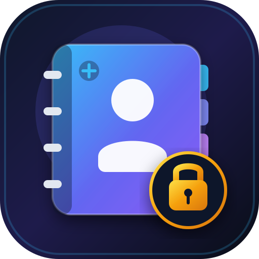

  

<h1 align="center">📇 Annuaire Privé • Dr Thomas Lefèvre</h1>

  Application Web Progressive (PWA) privée et chiffrée de bout en bout par code PIN (<strong>PBKDF2-HMAC-SHA256 • 100 000 itérations</strong>). 
  Regroupe <strong>291 contacts Pro (AP-HP Cochin, Pitié-Salpêtrière, Confrères) & Perso</strong>, le mémo interactif des <strong>Postes & DECT d'Imagerie de Cochin</strong>, et l'index des <strong>774 documents importants</strong>.

---

## 🔒 Sécurité & Confidentialité
- **Zéro donnée en clair** dans le dépôt GitHub : l'intégralité des fiches contacts, numéros, emails et documents est chiffrée dans `vault.enc.json` (PBKDF2-SHA256 + flux SHA-256 + tag d'authentification HMAC-SHA256).
- **Déverrouillage rapide à 4 chiffres** via le pavé numérique tactile iOS ou le clavier, avec option de mémorisation locale et changement de code PIN à la volée.
- **Actions mobiles en 1 clic** : Appel direct, SMS, WhatsApp, Email, copie rapide de poste DECT, favoris épinglés et export vCard (`.vcf`) / Excel (`.csv`).
